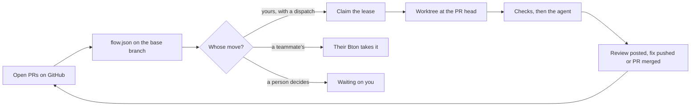
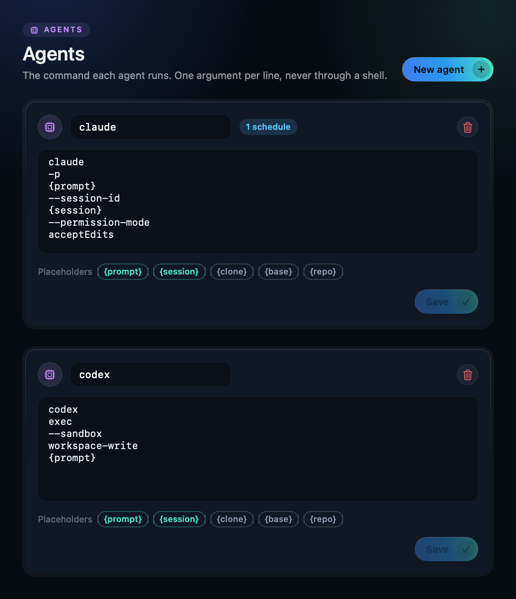

<p align="center">
  
</p>

<h1 align="center">Bton</h1>

<p align="center">
  <b>Your team's pull requests, moved forward by coding agents.</b><br>
  A macOS menu bar app. No server, no bot account: GitHub is the only shared state.
</p>

<p align="center">
  
  
  
  
</p>

```bash
curl -fsSL https://raw.githubusercontent.com/danieltamas/bton/main/install.sh | bash
```

<p align="center">
  
</p>

Bton watches every open PR in your repos, works out whose move it is, and starts the moves that
are yours with a headless agent. Reviews get written and posted, fixes get pushed, approved PRs
get merged. You see what each agent is doing and what it cost, and you step in only where the
flow says a person decides.

## Why Bton

- **Whose move is it?** Every PR shows its next move (`review`, `fix`, `merge`, `decide`) and
  who owns it. The menu bar counts the moves waiting on you.
- **Agents that start themselves.** A move that is yours starts on its own: a fresh worktree at
  the PR's head, the repo's checks, then Claude Code, Codex or any CLI agent you configure.
- **Exactly one Mac per move.** Every teammate runs their own Bton with their own `gh` login. A
  lease on GitHub makes sure one Mac takes each move, and nobody runs a server.
- **Costs you can see.** Each job shows its model and its API-equivalent cost; the panel totals
  today and this week.
- **Your flow, in your repo.** `.bton/flow.json` on the base branch says who moves next and what
  runs. A PR can never change the rules it is judged by.
- **Scheduled agents.** Triage issues nightly, refresh docs weekly: any prompt, any repo, on a
  timer, in a clean worktree.

<table>
  <tr>
    <td width="50%"></td>
    <td width="50%"></td>
  </tr>
  <tr>
    <td align="center"><b>Pull requests</b><br>The next move on every PR, and the agent at work.</td>
    <td align="center"><b>Jobs</b><br>Every agent and command, live, with Retry on a failure.</td>
  </tr>
</table>

## How it works



1. On a timer, Bton reads each watched repo's open PRs and the flow on the branch PRs merge into.
2. The flow turns each PR into a move and an owner.
3. For a move that is yours and has a dispatch entry, Bton claims the PR's lease, makes a
   worktree at the PR's head, runs the flow's checks and starts the agent there.
4. A review agent's final message is posted as the PR comment; a merge runs the repo's merge
   command. The next move follows from what changed on GitHub.

[`docs/FLOW.md`](docs/FLOW.md) describes the flow schema, and
[`examples/team.flow.json`](examples/team.flow.json) is a complete three-tier review flow.

## Install

```bash
curl -fsSL https://raw.githubusercontent.com/danieltamas/bton/main/install.sh | bash
```

That is all. It downloads the latest release, checks it against the release's `SHA256SUMS`,
puts `Bton.app` in `/Applications` (it opens at login from then on) and the `bton` CLI in
`~/.local/bin`. Run it again to update: a running Bton's agents keep running and the new version
adopts them. `BTON_VERSION=x.y.z` before `bash` pins a release.

You need macOS 14 or later, [`gh`](https://cli.github.com) logged in (`gh auth login`), and an
agent CLI: [Claude Code](https://docs.anthropic.com/en/docs/claude-code) (`claude`), with
[Codex](https://github.com/openai/codex) optional as an agent or a second opinion.

<details>
<summary>Build from source</summary>

```bash
git clone https://github.com/danieltamas/bton.git && cd bton
scripts/install-from-source.sh
```

Needs Xcode with Swift 6.2. Releases are reproducible: `scripts/release.sh <x.y.z> --verify`
builds a clean tagged clone twice with the Xcode build pinned in `Support/toolchain` and fails if
one byte differs.

</details>

## Set up

Click the menu bar icon, then the gear for Settings.

<p align="center">
  
</p>

- **Repos:** drop a project folder. Bton reads the GitHub repo from its `origin` and makes its
  worktrees in that clone. Pick the branch PRs merge into: Bton reads `.bton/flow.json` there,
  never from a PR. A repo's environment (`KEY=VALUE` lines, such as a local test database's
  `DATABASE_URL`) goes to its checks, merge commands and agents on this Mac. Bton keeps `PATH`,
  `HOME`, `GIT_*` and `BTON_*` for itself.
- **Agents:** the command each agent runs, one argument per line, with `{prompt}` and
  `{session}`; `{clone}`, `{base}` and `{repo}` are filled from the repo a job works. These are
  the agents this Mac may start unattended, never the repo's choice.
- **Schedules:** an agent with your prompt, in one repo, every N minutes, hours or days, in a
  fresh worktree of the base branch. A schedule can pin its model, run only when a PR changed,
  and ask other agents for a second opinion.
- **Prices:** fetched daily from LiteLLM's public model price list. Add a price only for a model
  the feed lacks. A model without a price shows "no price", never $0.

<p align="center">
  
</p>

Then add a flow: copy `examples/team.flow.json` to `.bton/flow.json` on the branch PRs merge
into, and change the logins, headings and commands to your team's.

## Security

Bton is built for a team that trusts its collaborators. It dispatches only for PRs whose author
is an owner, member or collaborator of the repo and counts reviews only from those, but checks
and agents run the PR's own code on the Mac that takes the move.

- Every Claude Code agent is hardened at launch: a PR's `.claude/settings.json`, `CLAUDE.md` and
  `.mcp.json` never load, GitHub writes that skip the merge gate are denied, and Claude Code's
  sandbox is always on.
- A repo's environment reaches the PR's own code, so give it only values meant for that code,
  such as a local test database. Bton masks longer values in the review comments it posts; job
  logs and an agent's own `gh` posts are not masked.
- Protect your base branch: nothing on the client stops an agent with `git` from pushing to it.

Read the threat model in [`SECURITY.md`](SECURITY.md) before pointing Bton at a repo; it also says
how to report a vulnerability.

## CLI

```bash
bton moves <owner/name>   # the flow's verdict on each open PR
bton prs                  # open PRs with their costs
bton jobs                 # every job this Mac ran
bton watch                # the app's loop without a UI
bton lease claim|renew|release|check   # the dispatcher's lease, for scripts
```

Everything Bton keeps lives in `~/.bton` (mode 0700), or in `$BTON_HOME` when set. Settings
writes `config.json` there, and a hand edit is read on the next sync.

## Develop

```bash
swift build
swift test                 # BTON_SANDBOX=<owner/name> adds the live GitHub lease tests
swift run Bton             # quick run, SF Symbol icon instead of the brand icon
scripts/bundle.sh          # build/Bton.app, ad hoc signed
BTON_E2E_REPO=<owner/name> scripts/e2e.sh   # two headless instances against a scratch repo
swift run Bton --render-screenshots <dir>   # the README's images, from made-up data
```

## License

MIT, see [LICENSE](LICENSE). The Claude and OpenAI marks in `Brand/vendors/` (from simple-icons)
identify the vendors and are trademarks of their owners.
