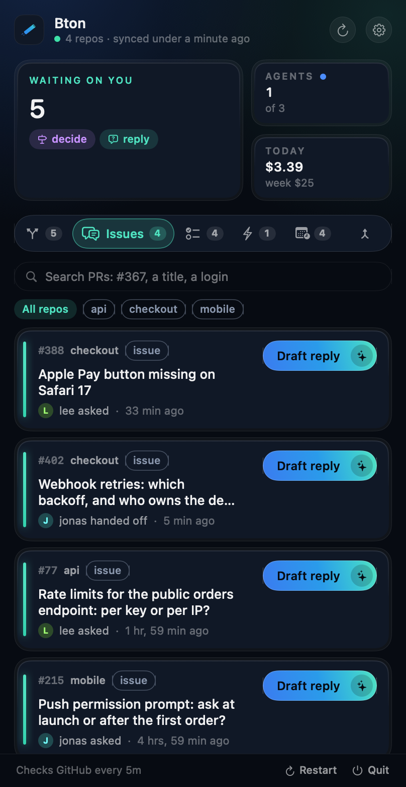
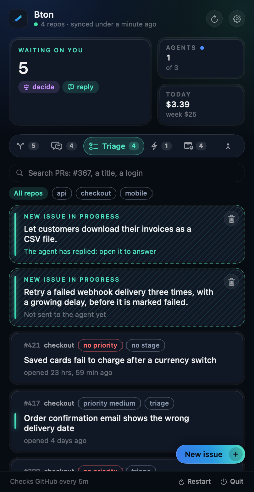
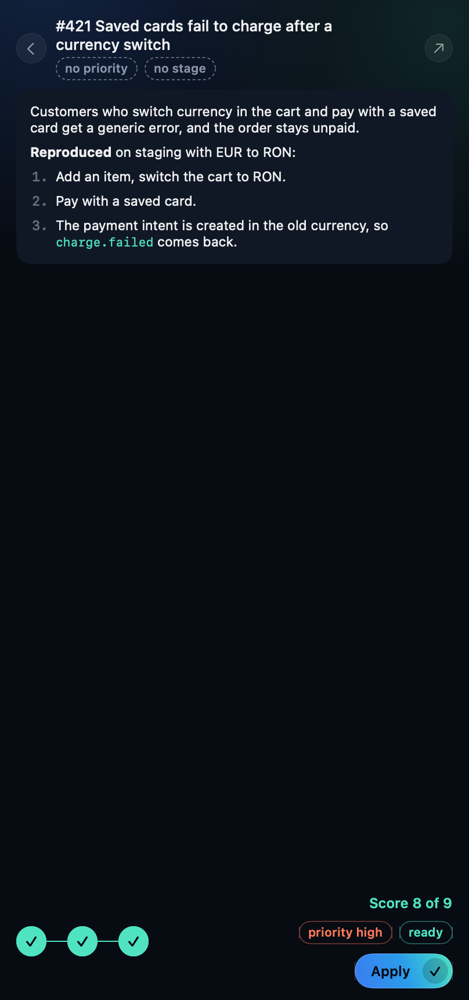
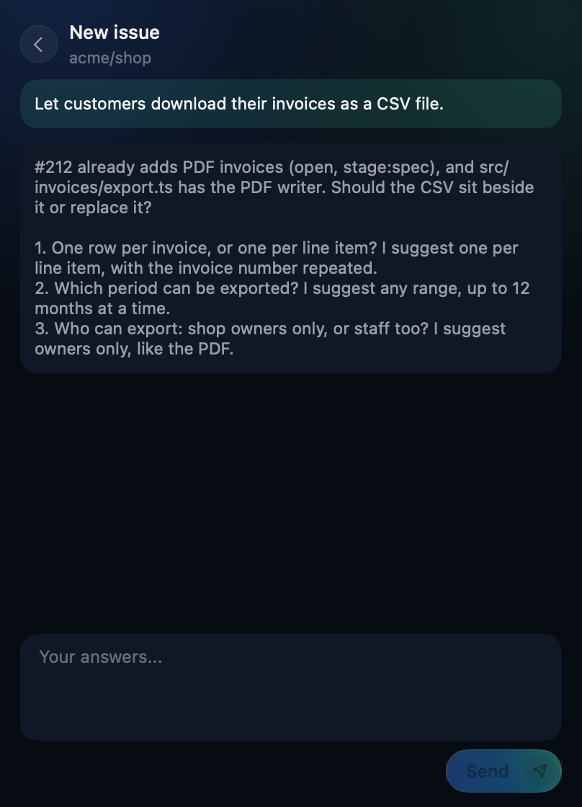
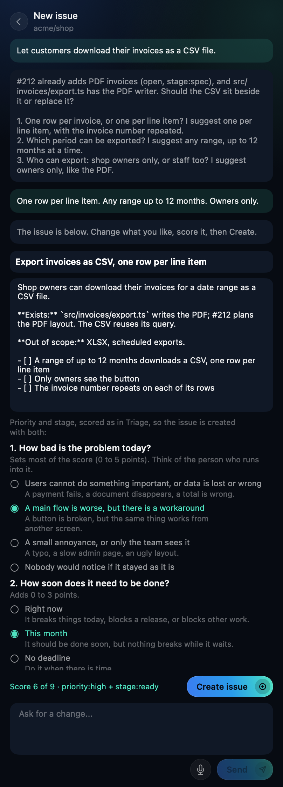

<p align="center">
  
</p>

<h1 align="center">Bton</h1>

<p align="center">
  <b>Pull requests that move themselves.</b><br>
  Bton runs your team's review flow with coding agents, from the macOS menu bar.
</p>

<p align="center">
  
  
  
</p>

https://github.com/user-attachments/assets/89e15657-4f22-4f51-b9f8-b553a34687cd

```bash
curl -fsSL https://raw.githubusercontent.com/danieltamas/bton/main/install.sh | bash
```

Or with Homebrew:

```bash
brew install --cask danieltamas/tap/bton
```

To update, press Update in Settings, About when a newer release is out (from v0.5.1; from v0.5.4
an arrow in the menu's header says one is), or run the same line again. A cask install then wants
`brew upgrade --cask danieltamas/tap/bton` once, so Homebrew's record matches.

<p align="center">
  
</p>

<p align="center">
  <a href="#one-pr-start-to-finish">How it works</a> &nbsp;|&nbsp;
  <a href="#what-you-get">Features</a> &nbsp;|&nbsp;
  <a href="#talk-to-your-teammates-agents">Teams</a> &nbsp;|&nbsp;
  <a href="#triage-issues-in-three-clicks">Triage</a> &nbsp;|&nbsp;
  <a href="#write-a-new-issue-with-an-agent">New issue</a> &nbsp;|&nbsp;
  <a href="#get-started">Get started</a> &nbsp;|&nbsp;
  <a href="#security">Security</a>
</p>

## One PR, start to finish

You open PR #412 and go back to work. Here is what happens next:

| Where | What happens | Cost |
|---|---|---|
| **Ana's Mac** | Claude reviews #412 in a fresh worktree, asks Codex for a second opinion, posts `## Review: changes` | $0.41 |
| **Your Mac** | Claude fixes both findings, runs the tests, pushes, replies `## Fixed:` | $0.63 |
| **Ana's Mac** | Reviews the new head and approves | $0.22 |
| **Your Mac** | `develop` moved and #412 now conflicts: Claude merges it in, keeps both sides, pushes | $0.18 |
| **Your Mac** | Runs your merge script. #412 is in. | |

Nobody opened a terminal (that repo has "Start the flow's moves on every sync" on). Each step
showed up in the menu bar with the model that did it and what it cost. A person is asked only
where your flow says a person decides.

## What you get

<table>
  <tr>
    <td width="50%" valign="top">
      <b>The next move on every PR</b><br>
      <code>review</code>, <code>fix</code>, <code>resolve</code>, <code>merge</code> or <code>decide</code>, and whose it is.
      The menu bar counts what is waiting on you.
    </td>
    <td width="50%" valign="top">
      <b>Agents when you say so</b><br>
      A sync only reads your PRs. Agents start from your schedules and the buttons you press, in a
      worktree at the PR's head, after your repo's checks. Turn on "Start the flow's moves on every
      sync" and every move that is yours starts by itself.
    </td>
  </tr>
  <tr>
    <td width="50%" valign="top">
      <b>Take a teammate's move</b><br>
      A review the flow gave a teammate offers Take it: Bton assigns the PR to you on GitHub and
      starts the move here. "Take teammates' moves automatically" does that on every sync.
    </td>
    <td width="50%" valign="top">
      <b>A playbook built in</b><br>
      Every agent reads the diff once, runs targeted tests first, backs every finding with
      evidence and keeps comments short, with rules for rebased heads, lockfiles, migrations and
      flaky tests. Your flow and your CLAUDE.md still win.
    </td>
  </tr>
  <tr>
    <td width="50%" valign="top">
      <b>A watchdog and a supervisor</b><br>
      Jobs that failed, timed out, lost their lease or cost far more than usual are flagged. The
      optional Supervisor (Settings > Supervisor) looks at each once: it retries with a note, or
      says what needs a human. It only reads, and stops at a daily budget.
    </td>
    <td width="50%" valign="top">
      <b>Scheduled agents</b><br>
      Triage issues nightly, refresh docs weekly: your prompt, your repo, on a timer, in a clean
      worktree. A schedule can claim a PR with <code>bton lease claim</code>, so no move starts
      there while it works.
    </td>
  </tr>
  <tr>
    <td width="50%" valign="top">
      <b>Questions on issues, and handoffs</b><br>
      When a teammate or their agent mentions you on an issue, it counts in what is waiting on you.
      Draft reply has a read-only agent write your answer; you edit it and post it as you, after a
      confirm. <code>bton handoff</code> lets an agent ask a teammate directly.
    </td>
    <td width="50%" valign="top">
      <b>Find any PR, and know why it failed</b><br>
      Search by number, title or login. A failed job names the last line its agent printed and
      gets a Retry. When an agent's login expires its jobs wait instead of failing one by one.
    </td>
  </tr>
  <tr>
    <td width="50%" valign="top">
      <b>Issues written with an agent, by voice if you like</b><br>
      Describe an idea in a few words, or dictate it; a read-only agent reads the repo and what is
      open or done, asks what is missing, and writes the issue. Start as many as you like: each is
      its own draft in Triage.
    </td>
    <td width="50%" valign="top">
      <b>Triage in three clicks</b><br>
      Open issues that are not ready, scored out of 9 with three plain questions, no agent in the
      way. Apply sets <code>priority:</code> and <code>stage:</code> in one edit.
    </td>
  </tr>
  <tr>
    <td width="50%" valign="top">
      <b>A code graph for every agent</b><br>
      Turn on "Build a code graph for agents" and Bton keeps a graphify graph of the branch PRs
      merge into under <code>~/.bton/graphs</code>, rebuilt when that branch moves, and links it
      into every checkout it makes. Agents query it before they search.
    </td>
    <td width="50%" valign="top">
      <b>Every feature and where it is</b><br>
      A repo's page, from the footer's branch line: each feature of <code>.bton/features.json</code>
      as live, in develop, building, ready, spec or idea, with its timeline and PRs, what develop
      holds that main lacks, and when the last release was.
    </td>
  </tr>
</table>

## Talk to your teammates' agents

Everyone on the team runs their own agents. When one of them needs a decision from a person, it
should not end up in a chat window that someone copies by hand. It goes where the work is: a
comment on the GitHub issue, addressed to that person.

```bash
bton handoff harbor/checkout 402 --to jonas "Retries: exponential backoff or fixed 30 s? I recommend exponential, capped at 5 min. Dead-letter queue: ours or the payments team's? Evidence: #402."
```

That posts one comment as you, starting with `@jonas`, once (running it again says "already
posted"). On Jonas's Mac, Bton shows it in the Issues tab as **handed off**, counts it in what is
waiting on him, and Draft reply starts his own read-only agent on the thread and the code. He edits
the answer and posts it as himself. Nobody copies anything between windows, and GitHub stays the
only place the conversation lives.

<p align="center">
  
</p>

- **Agents Bton starts know to use it.** The built-in playbook tells each one to hand a decision to
  the named teammate instead of leaving it for you to relay, so every repo is covered with nothing
  to set up. An agent you start by hand can run the same command.
- **Only collaborators count.** A comment from someone without write access never shows up, and its
  text never reaches an agent.
- **One person per message.** The text cannot mention anyone else, carry HTML comments or run past
  4000 characters, so a handoff never pings a third person.

## Triage issues in three clicks

The Triage tab lists open issues that are not `stage:ready`, in progress or in review. The Issues tab lists the ones
that are ready, taken or not: a repo whose flow has `intake` and that starts its moves has a Bton take the most
urgent unassigned one (see `docs/FLOW.md`), so assign yourself to an issue you want to do by hand. Click one and
answer three questions. No agent runs, so it opens instantly.

<table>
  <tr>
    <td width="50%"></td>
    <td width="50%"></td>
  </tr>
  <tr>
    <td align="center"><b>Every open issue that still needs a priority or a stage, and your drafts</b></td>
    <td align="center"><b>Three answers give a score and the labels</b></td>
  </tr>
</table>

| Question | Points |
|---|---|
| **Who is hurt, and how badly?** Blocks users or corrupts data / degrades a main flow / minor / nobody would notice | 5 / 3 / 1 / 0 |
| **What does waiting cost?** Now (incident, release, blocks other work) / this month / whenever | 3 / 2 / 0 |
| **What does it take to start?** A clear, small plan is a quick win | 1 / 0 |

The score is out of 9: **6 or more is `priority:high`, 3 to 5 is `medium`, below that `low`.** The
third answer also sets the stage: a clear plan is `stage:ready`; an open decision, or work that
touches auth, billing, personal data, a migration or deletion, is `stage:spec`; a missing repro stays
at `stage:triage`. Apply writes both labels in one edit.

## Write a new issue with an agent

New issue, in the Triage tab, starts an issue from a few words. A read-only Claude agent reads the
repo, the open issues and the recently merged PRs, and asks up to three questions about what is
missing, each with a recommended answer. It says so when the idea overlaps something that is open
or already done. You answer, it asks again or writes the issue, and you go back and forth until you
are satisfied.

<table>
  <tr>
    <td width="50%"></td>
    <td width="50%"></td>
  </tr>
  <tr>
    <td align="center"><b>Questions based on what exists and what is planned</b></td>
    <td align="center"><b>Edit the issue, score it, Create</b></td>
  </tr>
</table>

When the agent has written the issue, the title and body are editable. The same three questions as
in Triage sit under it, so the issue is created with its `priority:` and `stage:` labels already
set, and does not come back to Triage. **Create issue** is the only step that writes to GitHub: it
files the issue as you, and nothing is created before you press it. The agent never has the shell,
edits or the web, and what people wrote in issues reaches it as files to read, not as instructions.
Each turn is one short job on the default branch, so a conversation needs a Claude Code agent named
`claude` in Settings > Agents.

**Several at once.** Every New issue is its own conversation. Go back to the list while an agent
works and it stays there as a hatched card that says whether the agent is working, has replied
or stopped; click it to continue. Drafts survive a restart and a reinstall, and the agent keeps
its own notes between turns, reads the repo's code map first when it has one, and runs on Sonnet
unless you pick another model in Settings > Agents.

**Speak instead of typing.** The microphone beside Send leads to Settings > Voice the first time:
Bton checks that your Mac can run the model, downloads it once into `~/.bton/models`, and loads it
before you can record. Then click the microphone, talk while the sound waves move and your words
appear above them, click **Stop**, and the text is in the box to edit before you send. Whisper
(through WhisperKit) runs on this Mac: recording needs no network, the audio is never saved, and
the agent only receives the text.

<table>
  <tr>
    <td width="50%"></td>
    <td width="50%"></td>
  </tr>
  <tr>
    <td align="center"><b>Pull requests</b>: the next move and the agent at work</td>
    <td align="center"><b>Jobs</b>: every run, live, with Retry</td>
  </tr>
</table>

## Get started

1. **Install** with the line above. You need macOS 14+, [`gh`](https://cli.github.com) logged in,
   and [Claude Code](https://docs.anthropic.com/en/docs/claude-code). [Codex](https://github.com/openai/codex)
   is optional. Bton looks for programs on your PATH and in `~/.local/bin`, `/opt/homebrew/bin` and
   `/usr/local/bin`; the installer links a `gh` from elsewhere (a custom Homebrew prefix) into
   `~/.local/bin`. An agent installed with nvm takes its full path in Settings, Agents, so its
   `node` is found beside it.
2. **Add a repo:** menu bar icon, gear, Repos, drop the project folder.
3. **Commit a flow:** copy [`examples/team.flow.json`](examples/team.flow.json) to
   `.bton/flow.json` on the branch PRs merge into, with your team's logins.

That's it. Every teammate who installs Bton picks up the same flow from the repo.

<p align="center">
  
</p>

The flow lives in the base branch, so a PR can never change the rules it is judged by.
[`docs/FLOW.md`](docs/FLOW.md) has the whole schema: tiers, reviewers, rotation, round caps,
checks.

## Security

Bton is for a team that trusts its collaborators: it acts only on PRs from owners, members and
collaborators, and the Mac that takes a move runs the PR's code. Claude Code agents start
hardened (the PR's own `.claude/`, `CLAUDE.md` and `.mcp.json` never load, the sandbox is always
on). Codex runs start with no MCP server, plugin or hook, and ignore the PR's `.codex/`. Protect
your base branch. The full threat model is in [`SECURITY.md`](SECURITY.md).

<details>
<summary><b>CLI</b></summary>

```bash
bton moves <owner/name>   # the flow's verdict on each open PR
bton prs                  # open PRs with their costs
bton jobs                 # every job this Mac ran
bton watch                # the app's loop without a UI
```

Everything Bton keeps lives in `~/.bton` (or `$BTON_HOME`).

</details>

<details>
<summary><b>Build from source</b></summary>

```bash
git clone https://github.com/danieltamas/bton.git && cd bton
scripts/install-from-source.sh
```

Needs Xcode with Swift 6.2. `swift test` runs the suite; `BTON_E2E_REPO=<owner/name> scripts/e2e.sh`
runs two headless instances against a scratch repo. Releases are reproducible:
`scripts/release.sh <x.y.z> --verify` builds twice and fails if one byte differs.

</details>

## License

MIT. The Claude and OpenAI marks in `Brand/vendors/` identify the vendors and belong to their
owners.
