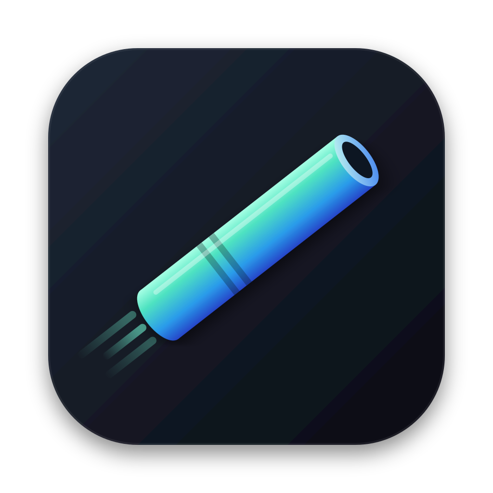
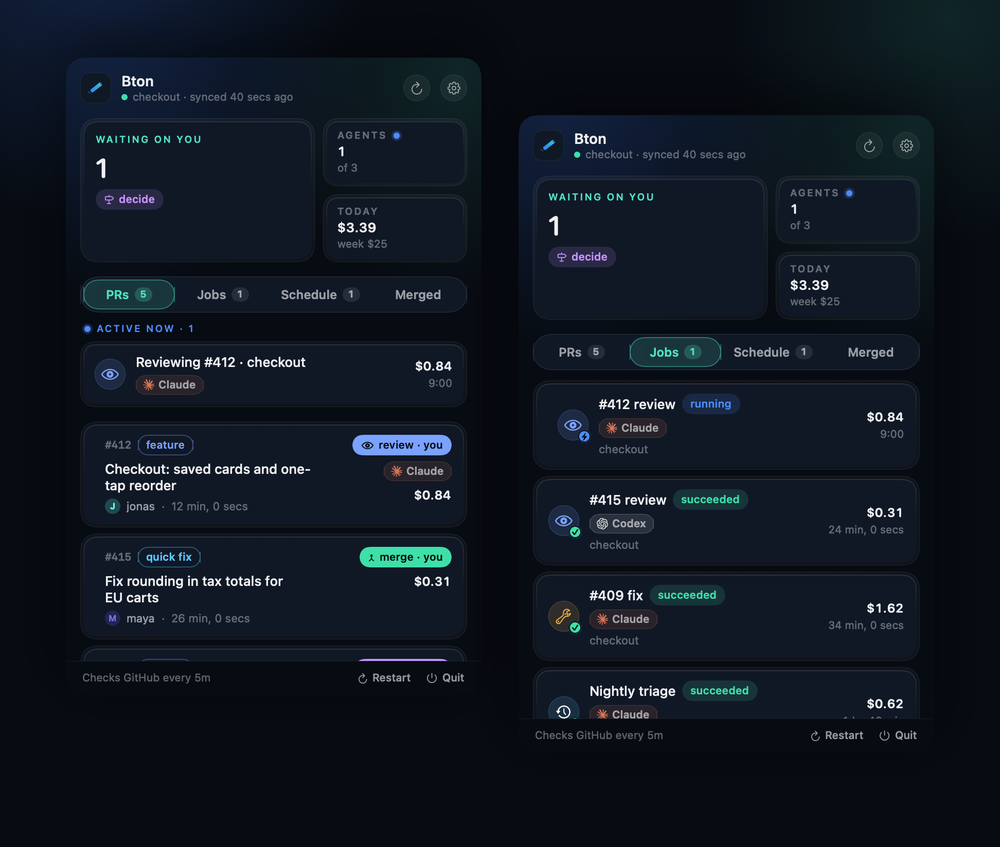
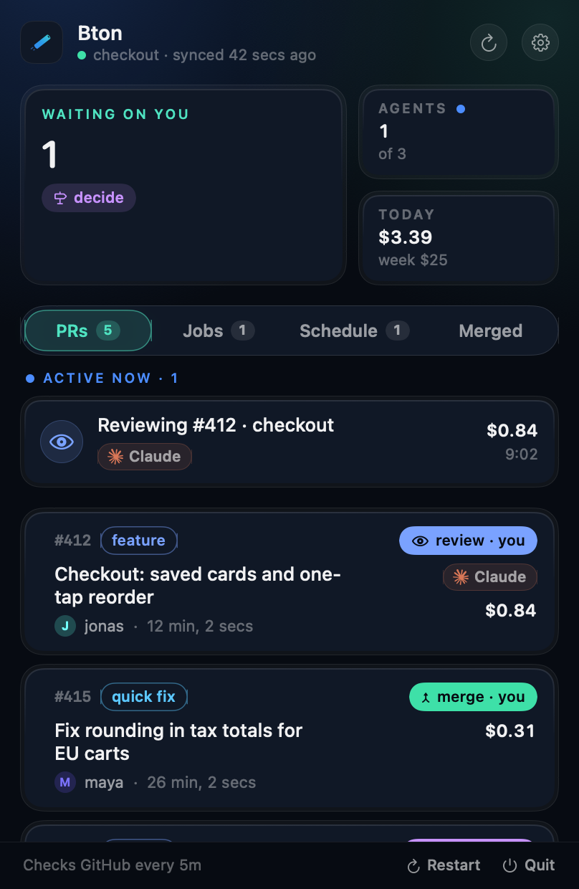
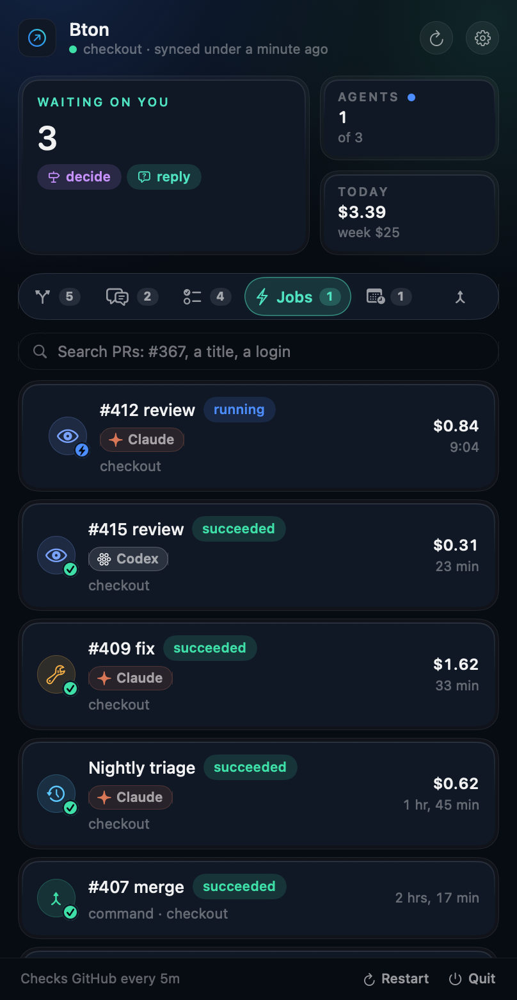
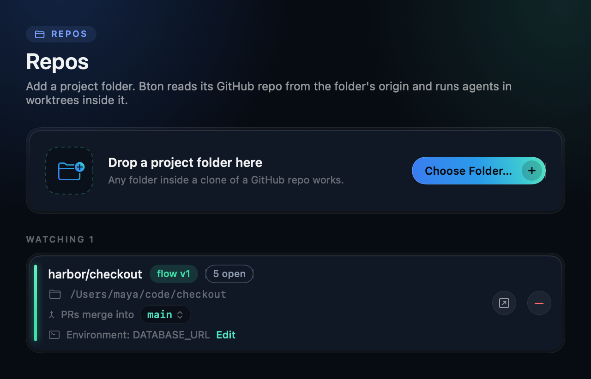

<p align="center">
  
</p>

<h1 align="center">Bton</h1>

<p align="center">
  <b>Pull requests that move themselves.</b><br>
  Bton runs your team's review flow with coding agents, from the macOS menu bar.
</p>

<p align="center">
  
  
  
</p>

```bash
curl -fsSL https://raw.githubusercontent.com/danieltamas/bton/main/install.sh | bash
```

To update, press Update in Settings, About when a newer release is out (from v0.5.1), or run
the same line again.

<p align="center">
  
</p>

## One PR, start to finish

You open PR #412 and go back to work. Here is what happens next:

| | | |
|---|---|---|
| **Ana's Mac** | Claude reviews #412 in a fresh worktree, asks Codex for a second opinion, posts `## Review: changes` | $0.41 |
| **Your Mac** | Claude fixes both findings, runs the tests, pushes, replies `## Fixed:` | $0.63 |
| **Ana's Mac** | Reviews the new head and approves | $0.22 |
| **Your Mac** | `develop` moved and #412 now conflicts: Claude merges it in, keeps both sides, pushes | $0.18 |
| **Your Mac** | Runs your merge script. #412 is in. | |

Nobody opened a terminal (that repo has "Start the flow's moves on every sync" on). Each step
showed up in the menu bar with the model that did it and what it cost. A person is asked only where your flow says a person decides.

## What you get

**The next move on every PR.** `review`, `fix`, `resolve`, `merge` or `decide`, and whose it is.
The menu bar counts what is waiting on you.

**Agents when you say so.** A sync only reads your PRs. Agents start from your schedules and from
the buttons you press: a worktree at the PR's head, your repo's checks, then Claude Code, Codex or
any CLI you configure. Turn on "Start the flow's moves on every sync" for a repo and every move
that is yours there starts by itself.

**A playbook built in.** Every agent Bton starts follows the same way of working a PR: read the
diff once, targeted tests first, every finding with evidence, scoped re-reviews, short comments,
and the edge cases of each move (rebased heads, lockfiles and migrations, flaky tests, wrong
findings, conflicts where both sides changed behaviour). Your flow and your CLAUDE.md still win.

**A watchdog and a supervisor.** Bton flags every job that failed, timed out, lost its lease or
cost far more than that move usually does, on its row and in a notification. Turn on the
Supervisor (Settings > Supervisor) and an agent looks at each flagged job once: it retries the
move with a note on what to do differently, or tells you what needs a human. It only reads: no
shell, no edits, no GitHub writes. It stops at a daily budget.

**Questions on issues.** When a teammate mentions you on an open issue, it shows under "Asked on
issues" on the PRs tab, counts in what is waiting on you and notifies you. Press Draft reply and
a read-only agent reads the thread and the code and drafts your answer. Edit it in place, then
Post reply comments it on the issue as you (after a confirm), or copy it. Nothing is posted
unless you press it.

**One Mac per move, no server.** Every teammate runs Bton with their own `gh` login. A lease on
GitHub hands each move to exactly one Mac. Name a work label for a repo (Settings > Repos) and a PR
carries it while any Bton works on it, so teammates without Bton see it on GitHub.

**Conflicts fix themselves.** When your PR falls behind its base and conflicts, an agent merges
the base in, resolves, tests and pushes. Any PR of yours GitHub can merge gets a Merge button
that runs your repo's own merge command, so its checks still decide: a merge a check stopped says
which check, and offers Retry merge. A Fix conflicts whose agent pushed nothing (it stopped for a
ruling) fails, links its report and offers a Retry. While an agent works a PR, its row offers no second start.

**Your develop and main stay current.** After every sync Bton fast-forwards your local working
branch and the default branch when they are only behind origin, so you and your agents start from
what is merged. A branch with commits of its own is never touched. The footer shows each one
against origin and what develop has that main lacks.

**Costs in plain sight.** Every job shows its model and its cost; the panel totals today and the
week.

**Scheduled agents.** Triage issues nightly, refresh docs weekly: your prompt, your repo, on a
timer, in a clean worktree. A schedule's row names the PR it is on and the PRs it worked on. A
schedule's agent can claim a PR with `bton lease claim`, so no move starts there while it works.

**Find any PR.** Search by number, title or login across open PRs, jobs and Merged. A move of
yours that failed gets a Retry on its row, and so does a failed issue draft.

**A failure says why.** A job whose agent exits names the last line it printed. When an agent's
login expired, its jobs wait instead of failing one after another: a notice says how to log in
again, and its jobs start once you press I've logged in.

<table>
  <tr>
    <td width="50%"></td>
    <td width="50%"></td>
  </tr>
  <tr>
    <td align="center"><b>Pull requests</b>: the next move and the agent at work</td>
    <td align="center"><b>Jobs</b>: every run, live, with Retry</td>
  </tr>
</table>

## Get started

1. **Install** with the line above. You need macOS 14+, [`gh`](https://cli.github.com) logged in,
   and [Claude Code](https://docs.anthropic.com/en/docs/claude-code). [Codex](https://github.com/openai/codex)
   is optional. Bton looks for programs on your PATH and in `~/.local/bin`, `/opt/homebrew/bin` and
   `/usr/local/bin`; the installer links a `gh` from elsewhere (a custom Homebrew prefix) into
   `~/.local/bin`. An agent installed with nvm takes its full path in Settings, Agents, so its
   `node` is found beside it.
2. **Add a repo:** menu bar icon, gear, Repos, drop the project folder.
3. **Commit a flow:** copy [`examples/team.flow.json`](examples/team.flow.json) to
   `.bton/flow.json` on the branch PRs merge into, with your team's logins.

That's it. Every teammate who installs Bton picks up the same flow from the repo.

<p align="center">
  
</p>

The flow lives in the base branch, so a PR can never change the rules it is judged by.
[`docs/FLOW.md`](docs/FLOW.md) has the whole schema: tiers, reviewers, rotation, round caps,
checks.

## Security

Bton is for a team that trusts its collaborators: it acts only on PRs from owners, members and
collaborators, and the Mac that takes a move runs the PR's code. Claude Code agents start
hardened (the PR's own `.claude/`, `CLAUDE.md` and `.mcp.json` never load, the sandbox is always
on). Codex runs start with no MCP server, plugin or hook, and ignore the PR's `.codex/`. Protect
your base branch. The full threat model is in [`SECURITY.md`](SECURITY.md).

<details>
<summary><b>CLI</b></summary>

```bash
bton moves <owner/name>   # the flow's verdict on each open PR
bton prs                  # open PRs with their costs
bton jobs                 # every job this Mac ran
bton watch                # the app's loop without a UI
```

Everything Bton keeps lives in `~/.bton` (or `$BTON_HOME`).

</details>

<details>
<summary><b>Build from source</b></summary>

```bash
git clone https://github.com/danieltamas/bton.git && cd bton
scripts/install-from-source.sh
```

Needs Xcode with Swift 6.2. `swift test` runs the suite; `BTON_E2E_REPO=<owner/name> scripts/e2e.sh`
runs two headless instances against a scratch repo. Releases are reproducible:
`scripts/release.sh <x.y.z> --verify` builds twice and fails if one byte differs.

</details>

## License

MIT. The Claude and OpenAI marks in `Brand/vendors/` identify the vendors and belong to their
owners.
